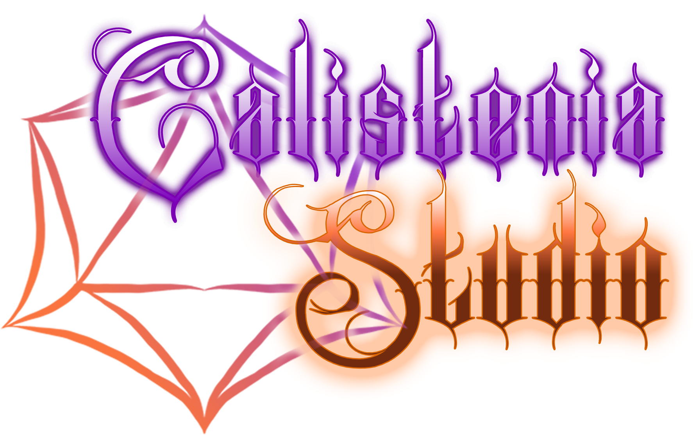

# Tormenta20: Melhor Amigo

Uma ficha dedicada ao Melhor Amigo da classe Treinador, integrada à Ficha Heroica e com suporte opcional à Forja Heroica.

**Dependência obrigatória:** instale e ative [Tormenta20: Ficha Heroica](https://foundryvtt.com/packages/tormenta20-ficha-heroica), versão 1.6.26 ou posterior. A Forja Heroica é opcional. Requer Foundry VTT 13 ou 14 e o sistema Tormenta20 1.5.015 ou posterior.

**Manifesto de instalação:** https://github.com/CalisteniaStudios/tormenta20-melhor-amigo/releases/latest/download/module.json

## Instalação e criação

1. Instale e ative **Tormenta20: Ficha Heroica** e este módulo no mundo de Tormenta20.
2. Disponibilize os compêndios que contêm os tipos e truques do Melhor Amigo. O módulo utiliza os documentos que você já possui; não inclui conteúdo de suplementos.
3. Use **Criar Ator → Melhor Amigo** ou o botão **Criar Melhor Amigo** no diretório de Atores. Se a Forja Heroica 0.2.0-alpha.7 ou posterior estiver ativa, use **Criar Ator → Forja Heroica → Melhor Amigo → Criar**.
4. Escolha o treinador, tipo, tamanho, três perícias diferentes, dano da arma natural, dano independente da segunda arma do Monstro e imagens do retrato e token. Complete a criação escolhendo os truques disponíveis.

Para uma ficha existente, escolha **Melhor Amigo** na configuração de ficha e arraste o ator do treinador para a janela. A ficha existente deve conter apenas a classe Melhor Amigo e um tipo compatível. A ficha não é convertida nem limpa automaticamente: faça uma cópia antes de adaptar personagens existentes.

## Vínculo com o treinador

- O retrato do treinador abre sua ficha. O painel mostra seus PV e PM atuais, incluindo PM temporários.
- Os PM apresentados na ficha do companheiro pertencem ao treinador. O companheiro conserva zero PM próprios na fonte dos dados.
- Habilidades e magias com custo de PM debitam o treinador, mesmo com o gasto automático de personagens comuns desativado. PM temporários são usados primeiro.
- Para consultar o vínculo, é necessário acesso de observador ao treinador. Para gastar seus PM, o jogador precisa ser proprietário das duas fichas. Não há concessão automática de permissões.
- Descansar o companheiro recupera somente seus PV. Isso não restaura os PM do treinador.

O módulo serializa gastos no mesmo navegador, incluindo treinador e companheiros. Não oferece uma transação distribuída entre navegadores: gastos simultâneos do mesmo treinador em sessões diferentes devem ser coordenados pela mesa.

## Evolução e truques

O nível preparado acompanha o treinador. **Evoluir Melhor Amigo** na Forja registra o nível e abre a seleção de truques, preservando os PV atuais. Treinador Eclético usa o nível total para as estatísticas, sem antecipar patamares de truques.

Treino Intensivo, quando adquirido, acrescenta PV, RD e espaços de truques conforme o nível. Treinamento Defensivo, Treinamento Marcial, Veloz, Anatomia Humanoide e os tipos são calculados sem duplicar efeitos do compêndio. Armas naturais recebem os ajustes de Animal, Amigo Feroz e Amigão.

O catálogo verifica tipo, nível, pré-requisitos específicos, duplicatas e espaços disponíveis. Ensinar Truque atribui uma aquisição real do treinador a um companheiro. Condicionamento Especial, Deslocamento Especial, Magia Inata, Sopro e Arma Natural Adicional pedem as escolhas necessárias.

- **Sopro:** escolha o dano ao aprender e os PM ao usar. Cada PM gera 2d8, limitado pelo Carisma do treinador. A CD usa seu Carisma.
- **Reanimação Sombria:** confirma o gasto conforme o patamar, restaura metade dos PV máximos e limita o uso a uma vez por cena. Ao terminar uma cena narrativa sem trocar o mapa, confirme com o mestre e use **Nova cena narrativa**.
- **Asas:** permite escolher pairar gratuitamente ou pagar 1 PM para voar naquela rodada. O botão registra o uso, sem mover o token ou controlar automaticamente a manutenção em rodadas futuras. Alado concede o deslocamento de voo permanente.

Poderes condicionais preservam os efeitos e descrições dos documentos instalados. Resistências de alvos, ações extras, posição, manobras e efeitos de parceiros dependem das automações do sistema e da adjudicação da mesa. O módulo não automatiza o combate inteiro.

## Aparência

A ficha herda temas, cores, molduras, fundos, logo da campanha, enquadramento das artes, favoritos e estilos Clássico, Abas, Lenda, Grimório e Saga da Ficha Heroica instalada. Os três últimos exigem uma versão da Ficha Heroica que já os ofereça.

Nenhuma imagem foi gerada para este módulo. Os ícones usados são referências ao Foundry e aos compêndios existentes; as artes são escolhidas pelo usuário.

## Validação desta versão

Versão local 0.1.4. A edição de armas usa os valores-base armazenados, impedindo que renomear ou fechar a janela grave novamente os bônus de Amigo Feroz e Amigão. A arma adicional do tipo Monstro não ocupa um espaço de truque; somente os poderes aprendidos são contados. Os campos de atributo de dano e bônus de ataque seguem o formato nativo do sistema. Corrige a Sabedoria inicial, preserva os bônus de atributos dos tipos no cálculo nativo, inclusive os efeitos dos itens iniciais no modo de transferência legado do Foundry 13 e restaura os botões de consulta e aprendizado de truques. Monstro permite escolher o dano da segunda arma natural, com custo de 1 PM do treinador. A correção de Sabedoria para fichas antigas só se aplica quando todos os atributos-base ainda correspondem à criação original do módulo. A criação permite três perícias iniciais distintas, usando a lista completa configurada no sistema, incluindo Ofícios. Corrige a inicialização com o pacote distribuído de Tormenta20 e a compatibilidade com módulos que estendem a classe de personagem. Testes com o código nativo de Tormenta20 1.5.015 e 1.6.1, fórmulas dos cinco tipos nos níveis 1 a 20, uso de habilidades e roteamento de PM. Prévia de interface com os templates da Ficha Heroica em Foundry 13 e 14, cinco estilos e duas larguras. A prévia e os testes isolados não substituem a conferência em um mundo autenticado com os demais módulos da mesa.

Projeto comunitário não oficial, sem afiliação ou endosso da Jambô Editora. O módulo utiliza a mesma licença de uso da Ficha Heroica, adaptada ao nome Melhor Amigo: uso gratuito, cópias de segurança e modificações privadas para uso próprio são permitidos. Revenda, redistribuição e os demais usos restritos exigem autorização prévia e expressa da Calistenia Studios. Consulte [LICENSE](LICENSE) para os termos completos e [THIRD_PARTY_LICENSES.md](THIRD_PARTY_LICENSES.md) para os materiais de terceiros.

A versão 0.1.4 também reconstrói a ficha a partir dos dados salvos ao atualizar o treinador, vincular e evoluir, evitando acúmulo de Força, Destreza e outros bônus ao gastar PM.
